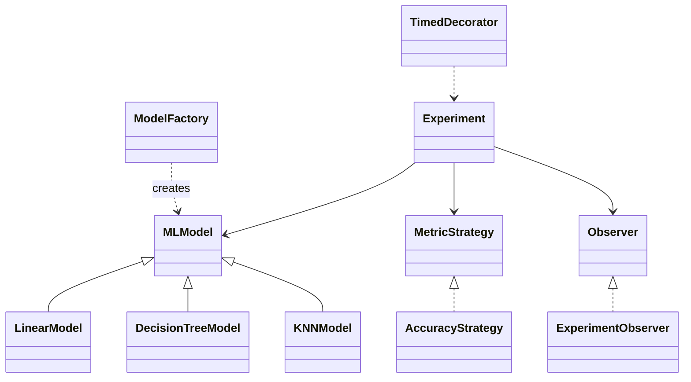

# NP - Ivan Cvorovic

Ovaj repozitorijum služi za mini projekte i završni projekat u okviru kursa Napredno programiranje.

## Zadatak 1: Priprema radnog okruženja

### Korišćeni upit za AI asistenta:
> "Napiši mi Python funkciju pod nazivom `prosjecna_cijena` koja prima listu brojeva (cijena) i vraća njihov prosek. Funkcija treba da bude otporna na greške, odnosno da vrati 0.0 ako je lista prazna. Takođe, napiši Pytest testove za tu funkciju koji pokrivaju normalan slučaj, slučaj sa jednim elementom i praznu listu."

### Uočeni nedostaci generisanog koda:
* AI u početku nije uvijek stavio *type hinting* (`list[float] -> float`), što je dobra praksa u Pythonu.
* Inicijalna verzija testova koje je AI predložio nije testirala slučaj prazne liste, već je bacala `ZeroDivisionError`. Morao sam da dopunim prompt da bi AI dodao `if not cijene: return 0.0`.
* AI je predložio korišćenje `numpy.mean()` funkcije što zahtijeva dodatnu instalaciju biblioteke, pa sam ga zamolio da koristi ugrađene Python funkcije `sum()` i `len()` kako bi kod bio lakši i bez zavisnosti.

* ---

---

## Mini projekat 1: Refaktoring sistema za obdu rezervacija

Kao osnovu za ovaj mini projekat uzeo sam monolitni skript za obradu rezervacija i izvršio njegov refaktoring. Kompletan kod i testovi nalaze se u fajlu `np_ime_prezime.ipynb`.

### Proces rada i korišćeni AI prompt
Prilikom refaktoringa koristio sam AI asistenta kao pomoć za implementaciju SOLID principa. Inicijalni upit je bio:
> "Treba mi Python kod za obradu rezervacija. Molim te primeni principe Single Responsibility i Dependency Inversion. Koristi `typing.Protocol` za apstrakciju izvora podataka (Repository) i servisa za notifikacije. Takođe, obezbedi zamenske (fake) klase za testiranje i napiši najmanje 3 Pytest testa."

### Kritički osvrt na generisani kod (uočeni nedostaci i ispravke)
Nakon analize koda koji je AI generisao, uočio sam nekoliko stvari koje sam morao ručno da ispravim:
1. **Nedostatak apstrakcije:** AI je u prvoj iteraciji klasu `ObradaRezervacija` direktno vezao za konkretne klase, što krši Dependency Inversion. Ispravio sam to uvođenjem `Protocol` klasa (`RezervacijaRepository` i `NotifikacioniServis`) i dodavanjem *type hintinga* u konstruktor.
2. **Slabo pokriveni testovi:** Generisani testovi su pokrivali samo "srećan put" (happy path). Morao sam da dopunim testove tako što sam dodao proveru rada funkcije `generisi_izvjestaj()` na praznoj listi rezervacija, kako bih sprečio potencijalne greške u produkciji.
3. **Prilagođavanje okruženju (Colab):** Zbog povremenih nestabilnosti Google Colab servera i greške `Failed to fetch`, odlučio sam da izbegnem spoljne zavisnosti poput `pytest` biblioteke. Testove sam prilagodio da koriste ugrađene `assert` naredbe unutar obične Python funkcije, što omogućava da se testiranje izvrši bez ikakvih dodatnih instalacija.

## Mini projekat 2 – Mini framework za ML eksperimente

Cilj projekta je implementacija jednostavnog frameworka za eksperimente mašinskog učenja u Pythonu, uz primjenu sljedećih dizajn obrazaca:

- **Factory:** Kreiranje ML modela (Linearni model, Decision Tree, kNN).
- **Strategy:** Različite metrike za evaluaciju modela.
- **Observer:** Praćenje događaja tokom treniranja.
- **Template Method:** Definisanje toka ML eksperimenta.
- **Decorator:** Mjerenje vremena izvršavanja.

### Demonstracija

Framework se demonstrira na Iris skupu podataka korišćenjem modela iz biblioteke scikit-learn.

### Testiranje

Testiranje se vrši pomoću pytest biblioteke, uz najmanje pet testova.

Pokretanje testova:

```bash
pytest -v
```

### Mermaid dijagram klasa



### AI alati

AI alati korišćeni su kao pomoć pri razumijevanju dizajn obrazaca, organizaciji koda i pisanju dokumentacije.

## Mini projekat 3: Testiran i obezbijeđen API

U okviru ovog mini projekta kreirana je FastAPI aplikacija sa dva endpointa (`POST /items/{item_id}` i `GET /items/{item_id}`). Fokus je bio na testiranju, kontinuiranoj integraciji (CI) i bezbjednosnoj analizi.

### Struktura projekta
- `app/main.py` – FastAPI aplikacija i rute.
- `tests/test_main.py` – 8 pytest testova (uključujući neispravne unose i granične slučajeve).
- `requirements.txt` – Zavisnosti projekta.
- `.github/workflows/ci.yml` – GitHub Actions pipeline (ruff, mypy, pytest).

### Analiza rizika i mjere smanjenja

1. **Rizik: Neispravni ili zlonamjerni unosi korisnika (Input Validation)**
   - *Opis:* Korisnik može poslati podatke koji nisu u skladu sa očekivanim formatom (npr. negativna cijena, tekst umjesto broja), što može dovesti do grešaka u radu aplikacije.
   - *Mjera smanjenja:* Korišćenje Pydantic modela za strogu validaciju tipova i ograničenja (npr. `gt=0` za cijenu, `min_length=2` za naziv). Implementirani su testovi koji pokrivaju neispravne unose i provjeravaju da API vraća `422 Unprocessable Entity`.

2. **Rizik: Bezbjednosne ranjivosti u zavisnostima (Third-party Libraries)**
   - *Opis:* Biblioteke trećih strana (poput FastAPI-ja ili Uvicorn-a) mogu imati poznate ranjivosti koje napadači mogu iskoristiti.
   - *Mjera smanjenja:* Redovno pokretanje `pip-audit` alata radi otkrivanja ranjivih verzija paketa i `bandit` alata za statičku analizu koda. Ovi alati su integrisani u CI proces.

3. **Rizik: Greške u logici i regresije pri izmjenama koda**
   - *Opis:* Izmjene u kodu mogu nehotice pokvariti postojeću funkcionalnost (regresija) ili unijeti logičke greške koje nisu očigledne.
   - *Mjera smanjenja:* Uspostavljanje automatizovanog CI pipeline-a (GitHub Actions) koji se pokreće pri svakom `push`-u. Pipeline obavezno prolazi kroz `ruff` (linting), `mypy` (provjera tipova) i `pytest` (jedinični testovi). Svaki neuspešan test blokira spajanje koda (merge).

### AI alati
AI asistent (ChatGPT) korišćen je kao pomoć pri struktuiranju projekta, pisanju testova i dokumentacije.
